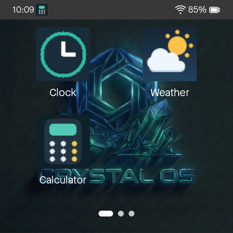
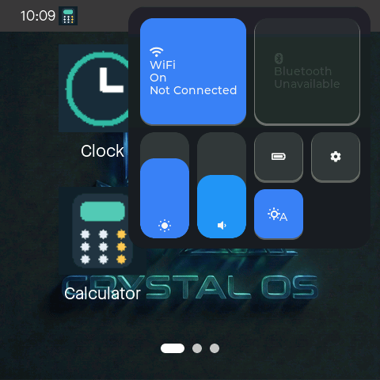
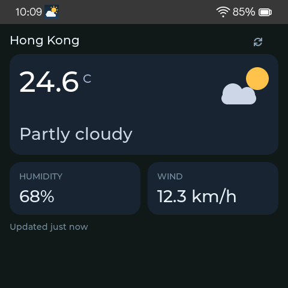
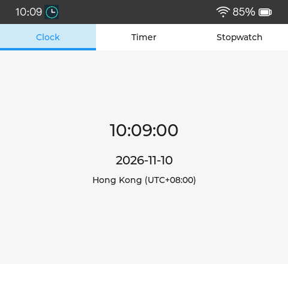
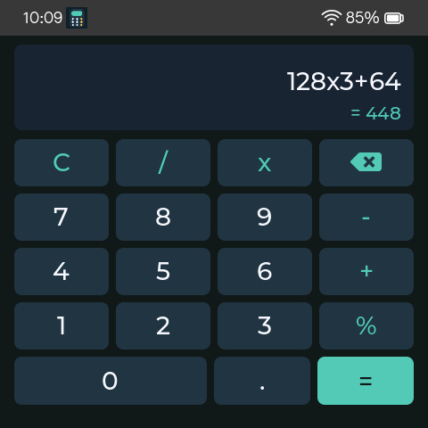
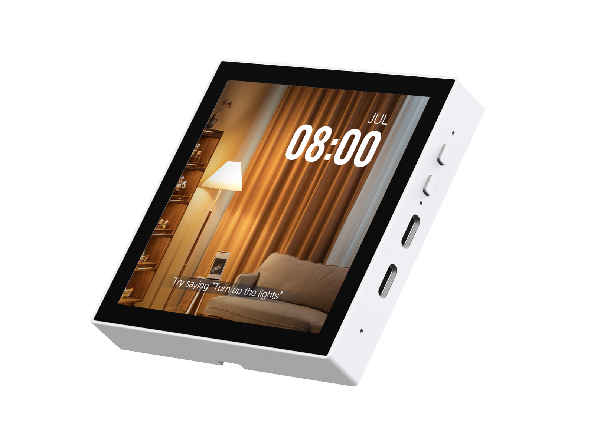
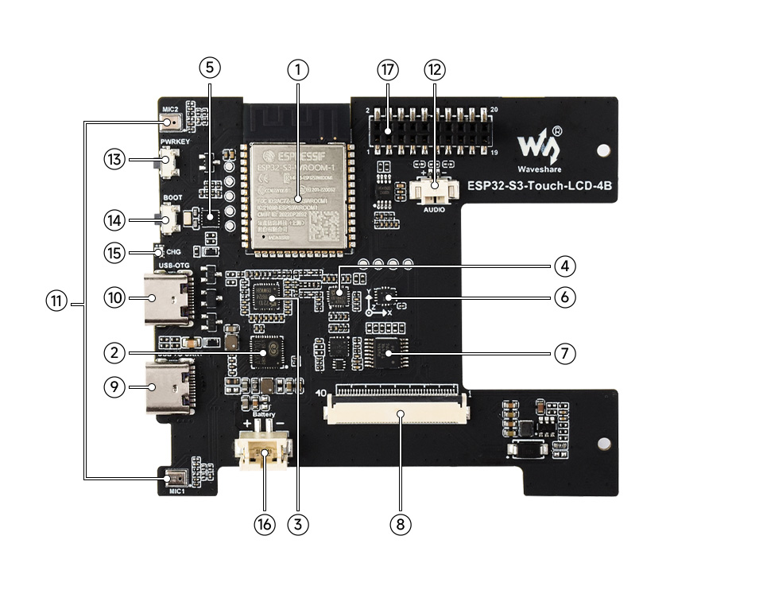

# Crystal OS

[](LICENSE.md)

A touch-first shell and app framework for the **Waveshare ESP32-S3-Touch-LCD-4B**,
the 4-inch, 480 × 480 ESP32-S3 panel in an **86-box form factor**. Crystal OS
builds on LVGL and Espressif's `esp-brookesia` to bring swipeable app cards,
a paged launcher, Quick Settings, and everyday utilities to this board.

[Hardware](#supported-hardware) · [Build and flash](#build-and-flash) ·
[Documentation](#documentation) · [Project status](#project-status)

## Screenshots

| Launcher | Quick Settings | Weather |
|:---:|:---:|:---:|
|  |  |  |

| Clock | Calculator |
|:---:|:---:|
|  |  |

These 480 × 480 captures render the production LVGL interfaces on the host
with fixed sample data. See [screenshot generation](tools/README.md#readme-screenshots)
to regenerate them.

## Supported hardware

This repository's firmware targets the **Waveshare ESP32-S3-Touch-LCD-4B**.
Its display, touch, RTC, and power adapters use this board's hardware and the
`waveshare/esp32_s3_touch_lcd_4b` board support package. Other ESP32-S3 displays
require a matching board configuration and hardware adapters.

| 4-inch touch panel and enclosure | Onboard components |
|:---:|:---:|
|  |  |

*Hardware photos: Waveshare. The screen in the product photo shows the vendor's
demo UI; the Crystal OS captures are above. [Image sources and attribution](docs/images/README.md).*

| Component | Specification |
| --- | --- |
| Module | ESP32-S3-WROOM-1-N16R8 |
| Memory | 16 MB flash, 8 MB octal PSRAM |
| Display | 4-inch IPS RGB LCD, 480 × 480, ST7701 controller |
| Touch | GT911 capacitive touch over I2C |
| Timekeeping | PCF85063 RTC |
| Power | AXP2101 PMIC, USB-C power, lithium battery connector |

Board specifications, connector details, and schematics are available in the
[Waveshare hardware wiki](https://www.waveshare.com/wiki/ESP32-S3-Touch-LCD-4B).
The [board reference](reference/ESP32-S3-Touch-LCD-4B/) contains the vendor
examples and hardware resources.

## Features

- **Navigation:** swipe between app cards, browse launcher pages with horizontal
  swipes, and use system gestures for Home and overlays.
- **Quick Settings:** Wi-Fi, brightness, volume, energy saving, and automatic dimming.
- **Settings:** network configuration, timezone and manual time, weather location,
  timer alerts, and device information.
- **Apps:** Clock with timer and stopwatch, Weather, Calculator, and Dev Tester.
- **Manage Apps:** enable bundled apps live, disable them for the next reboot,
  reorder cards, and clear saved app data.
- **Shared services:** persistent app state, RTC and network time, Wi-Fi, power
  management, an on-screen keyboard, and a time/Wi-Fi/battery status bar.

The shell keeps one app active at a time. System services retain timers,
network state, and settings while app views are recreated, keeping the UI
within the board's memory budget.

## Build and flash

The current development stack uses **ESP-IDF 6.1**, **LVGL 8.4.0**, and
**esp-brookesia 0.4.2**. The repository includes a project-local Brookesia
override; see the [version strategy](docs/BROOKESIA_VERSION_STRATEGY.md).

From the repository root, activate your ESP-IDF installation and build:

```bash
# Replace this path with your ESP-IDF 6.1 installation.
source /path/to/esp-idf/export.sh
idf.py build
```

Connect the board over USB, then select its serial port and flash:

```bash
# Examples: /dev/cu.usbmodem101 on macOS, /dev/ttyACM0 on Linux, COM3 on Windows.
PORT=/dev/cu.usbmodem101
idf.py -p "$PORT" flash
idf.py -p "$PORT" monitor
```

The example uses a Bash/Zsh shell. Press `Ctrl+]` to exit the serial monitor.
For configuration, update-only flashing, and recovery, see the
[ESP-IDF command guide](docs/ESP_IDF_COMMAND_GUIDE.md),
[baseline flashing notes](docs/NO_BUS_BASELINE.md#build-and-flash), and
[USB recovery tools](tools/README.md#usb-recovery).

Host development currently provides a mock HAL and headless LVGL checks/captures.
A full interactive desktop simulator is still planned; see
[desktop simulation](docs/SIMULATOR.md) and [host tools](tools/README.md).

## Project status

Crystal OS is under development. Apps currently ship inside the firmware.
Bundled-app management through Phase 13.7 is implemented; the broader Phase 13.8
device regression pass and documentation closure remain pending.

- **Current firmware:** the no-bus baseline. Bus app development paused after
  internal DRAM exhaustion; its source and findings are preserved in
  [examples/bus_app](examples/bus_app/README.md).
- **Next platform track:** installable apps, packages, and a PC-assisted loader.
  Phases 14–17 are a [design proposal](docs/APP_PLATFORM.md), not implemented features.
- **Detailed progress:** see the [implementation plan](docs/IMPLEMENTATION_PLAN.md),
  [Phase 13 checklist](docs/PHASE_13_CHECKLIST.md), and
  [validation checklist](docs/VALIDATION_CHECKLIST.md).

## Project layout

```text
main/                        Firmware entry point and startup
components/crystal_shell/     App cards, gestures, Quick Settings, and overlays
components/crystal_app/       App lifecycle and bounded per-app state
components/crystal_registry/  Bundled-app enable state and launcher order
components/crystal_core/      Time, weather, power, and timer services
components/crystal_hal/       Hardware interfaces and board adapters
components/esp-brookesia/      Project-local Brookesia UI framework
components/*_app/             Bundled apps and development examples
sim/                         Host HAL mocks and screenshot harness
tools/                       Host checks, screenshot generation, and recovery
docs/                        Architecture, validation records, and images
examples/                    App-platform examples and archived Bus workload
reference/                   Vendor board resources and reference material
partitions.csv               Dual-OTA partition table and storage partition
sdkconfig.defaults           Firmware configuration defaults
```

## Documentation

| Topic | Start here |
| --- | --- |
| Architecture and app lifecycle | [Design](docs/DESIGN.md) · [Code guide](docs/CODE_GUIDE.md) |
| Build, flash, and recovery | [ESP-IDF commands](docs/ESP_IDF_COMMAND_GUIDE.md) · [Tools](tools/README.md) |
| Roadmap and validation | [Implementation plan](docs/IMPLEMENTATION_PLAN.md) · [Regression checklist](docs/VALIDATION_CHECKLIST.md) |
| Manage Apps | [Release notes](docs/PHASE_13_RELEASE_NOTES.md) · [Phase 13 checklist](docs/PHASE_13_CHECKLIST.md) |
| Host development | [Mock HAL](docs/SIMULATOR.md) · [Screenshot generation](tools/README.md#readme-screenshots) |
| Future installable apps | [App platform design](docs/APP_PLATFORM.md) · [Bus workload lessons](docs/APP_PLATFORM_BUS_LESSONS.md) |
| Bus reference and baseline | [Architecture handoff](examples/bus_app/ARCHITECTURE_HANDOFF.md) · [Baseline testing](docs/NO_BUS_BASELINE.md) |

Historical phase reports and proposals live in [docs/archive](docs/archive/).

## Use of AI

Generative AI assists with planning, implementation, review, testing, and
documentation for Crystal OS. The maintainer is responsible for design
decisions, review, and releases.

## Sponsor Me (With Thanks)

[](https://github.com/sponsors/SJoyTheHawk)

If you find Crystal OS useful, consider supporting its development through
GitHub Sponsors. Thank you for your support!

## License and attribution

Crystal OS is licensed under the
[PolyForm Noncommercial License 1.0.0](LICENSE.md)
(`PolyForm-Noncommercial-1.0.0`). Copyright (c) 2026 is jointly held by
[Rocky Road Studio](https://rockyroad.studio) and
[Bubstal Limited](https://bubstal.com). The project is authored by
Johnny "SJoyTheHawk" Sze. Commercial licensing enquiries may be sent to
[rockyroadstudio@outlook.com](mailto:rockyroadstudio@outlook.com).

This license applies only to original Crystal OS software, documentation, and
artwork. Third-party dependencies and reference materials retain their own
licenses. See [`NOTICE`](NOTICE) for third-party credits; the exact dependency
license files under `managed_components/` remain authoritative for
redistributed components.
