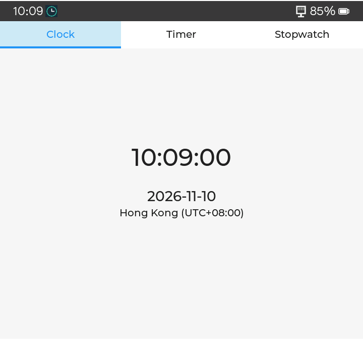
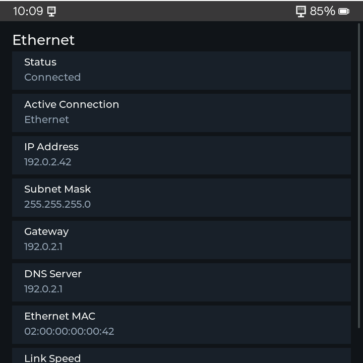
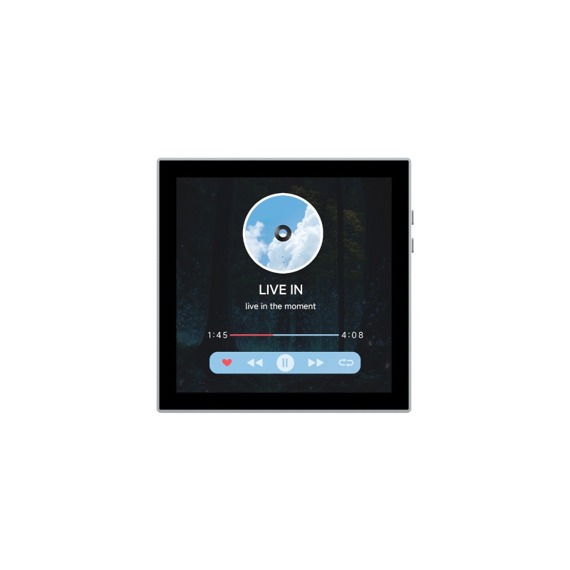

# Crystal OS

[](LICENSE.md)

Crystal OS is a touch-first shell and app framework built on LVGL and
esp-brookesia, with swipeable app cards, Quick Settings and installable apps.

**Current target:** Waveshare **ESP32-P4-WIFI6-Touch-LCD-4B**, with a
720 × 720 touch display, ESP32-C6 hosted Wi-Fi, and Ethernet. P4 bring-up,
visual/interaction acceptance (P4.2), and network expansion (P4.3) are complete
for their documented scopes as of **November 15, 2026**. Performance, soak,
and remaining feature qualification continue in P4.4. Phase 17 Lua runtime
support is implemented; Bus Lite **0.2.26** contains the Phase 4 refresh and
countdown implementation and OS clock-ready subscriptions. The user reports
the clock correction working on P4 (November 19, 2026); remaining soak and
network-recovery checks are tracked in the Phase 4 results.
The validated S3 baseline is preserved on branch `ESP32-S3-Touch-LCD-4B`.
See the [validation records](#project-status) and [documentation index](docs/README.md).

[Hardware](#supported-hardware) · [Build and flash](#build-and-flash) ·
[Documentation](#documentation) · [Project status](#project-status)

## Screenshots

| Launcher | Quick Settings | Weather |
|:---:|:---:|:---:|
|  |  |  |

| Clock | Calculator | Ethernet |
|:---:|:---:|:---:|
|  |  |  |

These **720 × 720 P4 captures** render the production LVGL interfaces and
Crystal P4 stylesheet in the headless host simulator. The gallery uses selected
bundled apps and fixed sample time, weather, battery, and network data; it is
not a photograph or a live device/network reading. Ethernet uses example
addresses. See [screenshot generation](tools/README.md#readme-screenshots)
to regenerate all six images.

## Supported hardware

Current development targets the **Waveshare ESP32-P4-WIFI6-Touch-LCD-4B**.
The tested board uses **ESP32-P4 revision 1.3** and a **JD9365DA** panel.
Crystal's P4 board adapter integrates Espressif Board Manager, the Waveshare
board pack, and the LVGL adapter with the existing app framework.

<p align="center">
  
</p>

*Hardware photo: Waveshare. Product imagery is separate from the Crystal OS
simulator captures above. [Image sources and attribution](docs/images/README.md).*

| Component | Current P4 configuration |
| --- | --- |
| Processor | ESP32-P4 rev1.3, 360 MHz; 180 MHz energy-saving setting |
| Memory | 32 MB flash, 32 MB HEX PSRAM at 200 MHz |
| Display | 4-inch, 720 × 720 MIPI-DSI LCD; tested JD9365DA panel |
| Touch | GT911 capacitive touch over I2C |
| Wireless | ESP32-C6 hosted Wi-Fi over SDIO; existing C6 firmware retained |
| Ethernet | IP101 RMII PHY; 100 Mbps link validated |
| Storage layout | Two 8 MiB OTA app slots, 4 MiB SPIFFS, 10 MiB LittleFS apps partition |

See the [P4 board reference](reference/ESP32-P4-WIFI6-Touch-LCD-4B-main/)
and [bring-up record](docs/ESP32_P4_PHASE1_VALIDATION.md) for hardware resources
and the tested configuration. The current profile is for rev1.x silicon;
rev3.x and other panel variants require separate qualification.

The previous **ESP32-S3-Touch-LCD-4B** baseline (480 × 480, 16 MB flash,
8 MB PSRAM) remains on the S3 branch. Its board defaults and
[reference resources](reference/ESP32-S3-Touch-LCD-4B/) are retained.

## Features

- **Navigation:** swipe between app cards, browse launcher pages with horizontal
  swipes, and use system gestures for Home and overlays.
- **Quick Settings:** Wi-Fi, brightness, volume, energy saving, and automatic dimming.
- **Settings:** Wi-Fi and Ethernet details, timezone and manual time, weather
  location, timer alerts, and device information; immediate page navigation
  and a larger P4 on-screen keyboard.
- **Apps:** Clock with timer and stopwatch, Weather, Calculator, Dev Tester,
  and the P4 Ethernet diagnostics app.
- **Manage Apps:** enable bundled apps live, disable them for the next reboot,
  reorder cards, and clear saved app data.
- **Lua packages:** install signed `.capp` apps through the Developer Tools
  control panel. Bus Lite 0.2.26 provides bundled route search, KMB/Citybus
  stops and live ETA, refreshed favorite ETAs, joint routes, eight favorites
  and five recent routes.
- **Shared services:** persistent app state, RTC and network time, Wi-Fi, power
  management, an on-screen keyboard, and a time/network/battery status bar.
- **P4 networking:** prefer Ethernet after DHCP, fall back to connected Wi-Fi,
  and share the selected route with Weather, SNTP, HTTPS, and the opt-in
  browser control panel.

The shell keeps one app active at a time. System services retain timers,
network state, and settings while app views are recreated, keeping the UI
within the board's memory budget. Volume and Bluetooth controls in the UI do
not imply P4 audio/Bluetooth support; audio, battery/PMIC, and additional
peripherals remain outside the accepted P4 scope.

## Build and flash

The current development stack uses **ESP-IDF 6.1**, **LVGL 8.4.0**, and
**esp-brookesia 0.4.2**. The repository includes a project-local Brookesia
override; see the [version strategy](docs/report/BROOKESIA_VERSION_STRATEGY.md).

From the repository root, activate ESP-IDF 6.1. On a **fresh checkout**, select
P4 explicitly: `sdkconfig` is local and ignored by Git, and the retained root
`sdkconfig.defaults` belongs to S3.

```bash
# Replace this path with your ESP-IDF 6.1 installation.
source /path/to/esp-idf/export.sh
# Once per fresh checkout (or when deliberately switching targets):
idf.py set-target esp32p4
```

CMake selects `sdkconfig.defaults.common`, `sdkconfig.defaults.esp32p4`, and
the generated Board Manager defaults for P4. The profile requires signed
applications. Create a development key once if you do not already have one,
then use the signing helper:

```bash
mkdir -p ~/.crystal_keys
if [ ! -f ~/.crystal_keys/dev_signing_key.pem ]; then
  espsecure generate-signing-key --version 2 --scheme rsa3072 ~/.crystal_keys/dev_signing_key.pem
fi
./scripts/build_dev.sh
```

The helper links the key into the ignored project signing-key path and runs
`idf.py build`. Once the target and key are configured, normal incremental
builds use `idf.py build`; there is no need to repeat `set-target`.

Connect the P4 over USB and select its serial port:

```bash
# Examples: /dev/cu.usbmodem101 on macOS, /dev/ttyACM0 on Linux, COM3 on Windows.
PORT=/dev/cu.usbmodem101
# Initial installation: includes the partition table and filesystem images.
idf.py -p "$PORT" flash monitor
# Later application-only updates on the matching Crystal partition layout:
idf.py -p "$PORT" app-flash monitor
```

Choose the appropriate flash command; a full flash also writes filesystem
images. The P4 console uses **1,000,000 baud**. The examples use Bash/Zsh;
press `Ctrl+]` to exit the monitor. Keep the working ESP32-C6 firmware in place.
For partition offsets, migration/recovery details, and the established local
workflow, use the [P4 build and validation guide](docs/ESP32_P4_PHASE1_VALIDATION.md#build-from-the-repository-root).
The [ESP-IDF command guide](docs/ESP_IDF_COMMAND_GUIDE.md) and
[baseline flashing notes](docs/report/NO_BUS_BASELINE.md#build-and-flash)
cover the preserved **S3** target; its flash/provisioning layout differs.

For host previews, run `python3 tools/capture_readme.py` to regenerate the P4
gallery without a device. This headless LVGL simulator and the mock HAL support
rendering and focused checks; an interactive SDL desktop simulator is still
planned. See [desktop simulation](docs/SIMULATOR.md) and [host tools](tools/README.md).

## Project status

Phases 14–16 are complete for development acceptance: package installation,
signature verification, the WiFi panel and USB CLI fallback, and the shared
UI/declarative framework. See the [closure record](docs/APP_PLATFORM_V2_PHASE_15_16_CLOSURE_CHECKLIST.md).

P4 acceptance, as recorded on November 15, 2026:

| Stage | Status and evidence |
| --- | --- |
| P4.1 — board bring-up | Signed build/flash, 720 × 720 display and touch, Wi-Fi, time, and HTTPS smoke checks pass. [Validation](docs/ESP32_P4_PHASE1_VALIDATION.md) |
| P4.2 — visuals and interaction | Accepted boot screen, cards, Quick Settings, immediate Settings navigation, Wi-Fi UI, and enlarged keyboard. [Validation](docs/ESP32_P4_PHASE2_VALIDATION.md) |
| P4.3 — network expansion | Accepted Ethernet, Wi-Fi fallback/reconnection, Ethernet-only Weather/SNTP/HTTPS, browser pairing/app-list access, and network indicator. [Validation](docs/ESP32_P4_PHASE3_VALIDATION.md) |
| P4.4 — qualification | Sustained performance/FPS, memory and network soaks, package/OTA flows, and remaining feature parity are still open. |
| Phase 17 — Lua runtime | Implemented; runtime/device checks remain tracked in the [test guide](docs/APP_PLATFORM_V2_PHASE_17_TEST_GUIDE.md). |
| Bus Lite 0.2.26 | Phases 1–4 implemented; Phase 3 persistence is accepted on P4. Clock-ready correction reported working; remaining Phase 4 reliability checks are recorded separately. [Phase 4 results](docs/BUS_APP_PHASE_4_RESULTS.md). |

These scoped acceptance records do not establish release readiness or a 60 fps
guarantee. Retained memory, HTTPS, and lifecycle findings are listed in the
[documentation index](docs/README.md#important-findings).

## Project layout

```text
main/                        Firmware entry point and startup
components/crystal_shell/     App cards, gestures, Quick Settings, and overlays
components/crystal_app/       App lifecycle and bounded per-app state
components/crystal_registry/  Bundled-app enable state and launcher order
components/crystal_core/      Time, weather, power, and timer services
components/crystal_hal/       Hardware interfaces, Wi-Fi, Ethernet, and route policy
components/crystal_board_p4/  P4 Board Manager/display facade
components/esp-brookesia/      Project-local Brookesia UI framework
components/*_app/             Bundled apps and development examples
sim/                         Host HAL mocks and screenshot harness
tools/                       Host checks, screenshot generation, and recovery
docs/                        Architecture, validation records, and images
examples/bus3p/              Current installable Bus Lite Lua package
examples/bus_app/            Historical S3 Bus implementation and catalog inputs
reference/                   Vendor board resources and reference material
partitions.esp32p4.csv        P4 dual-OTA, filesystem, and app storage layout
sdkconfig.defaults.esp32p4    P4 target profile (with common/Board Manager defaults)
partitions.csv               Preserved S3 partition layout
sdkconfig.defaults           Preserved S3 firmware defaults
```

## Documentation

Start with [docs/README.md](docs/README.md) for current plans, original design
references, implementation records and important unresolved findings.

| Topic | Start here |
| --- | --- |
| P4 migration | [Overview](docs/MIGRATION_PLAN_ESP32_P4.md) · [Detailed proposal](docs/CRYSTAL_OS_V2_P4_MIGRATION_PLAN.md) |
| App platform | [Overview](docs/APP_PLATFORM_V2_OVERVIEW.md) · [Implementation plan](docs/APP_PLATFORM_V2_IMPLEMENTATION_PLAN.md) |
| Bus Lite | [Package](examples/bus3p/README.md) · [Transformation plan](docs/README_BUS_TRANSFORMATION.md) · [Install/test](docs/BUS_APP_QUICK_START.md) |
| Original OS architecture | [Design](docs/v1_implementation_plan/DESIGN.md) · [Code guide](docs/v1_implementation_plan/CODE_GUIDE.md) |
| Build and recovery | [P4 build/flash](docs/ESP32_P4_PHASE1_VALIDATION.md#build-from-the-repository-root) · [S3 ESP-IDF commands](docs/ESP_IDF_COMMAND_GUIDE.md) · [Tools](tools/README.md) |
| Focused checks | [Regression guide](docs/APP_PLATFORM_V2_PHASE_15_16_TEST_GUIDE.md) |
| Host development | [Simulator status](docs/SIMULATOR.md) |

Historical reports and proposals live in [the archive](docs/archive/README.md).

## Known Issues

### P4 Wi-Fi recovery after signal loss

Some board runs show TLS timeouts followed by persistent DNS or reconnection
failures after signal loss. The root cause remains under investigation; the
logs alone do not establish an upstream socket leak. The HAL now rejects stale
SSID events and obsolete retry notifications, and Developer Tools includes
opt-in Wi-Fi diagnostics. Recovery under shielding still needs board validation.

Follow the [Wi-Fi checks](docs/WIFI_CHECKS.md) to capture interface, DNS and
transport evidence. A separate [19.4-minute Bus run](docs/test-evidence/wifi-checks/RESULTS.md)
completed 204 successful HTTPS requests after IP acquisition; it was not a
traffic-free idle test. Earlier power-management and socket-leak explanations
are retained as investigation notes, not confirmed fixes.

## Use of AI

Generative AI assists with planning, implementation, review, testing, and
documentation for Crystal OS. The maintainer is responsible for design
decisions, review, and releases.

## Sponsor Me (With Thanks)

[](https://github.com/sponsors/SJoyTheHawk)

If you find Crystal OS useful, consider supporting its development through
GitHub Sponsors. Thank you for your support!

## License and attribution

Crystal OS is licensed under the
[PolyForm Noncommercial License 1.0.0](LICENSE.md)
(`PolyForm-Noncommercial-1.0.0`). Copyright (c) 2026 is jointly held by
[Rocky Road Studio](https://rockyroad.studio) and
[Bubstal Limited](https://bubstal.com). The project is authored by
Johnny "SJoyTheHawk" Sze. Commercial licensing enquiries may be sent to
[rockyroadstudio@outlook.com](mailto:rockyroadstudio@outlook.com).

This license applies only to original Crystal OS software, documentation, and
artwork. Third-party dependencies and reference materials retain their own
licenses. See [`NOTICE`](NOTICE) for third-party credits; the exact dependency
license files under `managed_components/` remain authoritative for
redistributed components.
